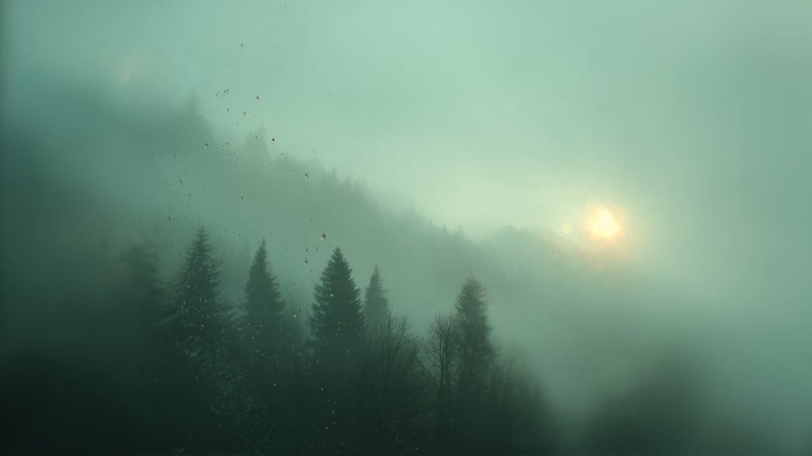

# Cool Dawn

Soft morning light through misted glass, with muted sage accents and a coordinated dark interface.


## Install

For **Omarchy 4 with Omarchy Shell**:

```sh
omarchy theme install https://github.com/erikrjohansson/omarchy-cool-dawn-theme
```

## Update

To get new wallpapers and fixes, update your installed themes, then apply Cool Dawn again so Omarchy picks up the new files:

```sh
omarchy theme update
omarchy theme set cool-dawn
```

## Remove

Switch to another theme first (for example with `omarchy theme switcher`), then remove Cool Dawn:

```sh
omarchy theme remove cool-dawn
```

## The theme

- A foggy forest at dawn seen through misted glass, with condensation and drops on the pane.
- A softly tinted top bar that keeps its text readable over the bright sky.
- Deep green-gray surfaces, sage accents, soft ivory text, and pale sun-gold for warnings.
- Translucent menus and shell panels, coordinated terminal and editor colors, GTK 3 / GTK 4 styling, and Adwaita icons.

## Wallpapers

Two 6K (6016 × 3384) wallpapers: misted glass (default) and a misty mountain slope. Switch between them with `omarchy theme bg next`, or from the Omarchy menu under Style → Background.

<table>
  <tr>
    <td width="50%"></td>
    <td width="50%"></td>
  </tr>
  <tr>
    <td align="center">Misted glass</td>
    <td align="center">Mountain</td>
  </tr>
</table>

## Misted Glass collection

[Misty Sunset](https://github.com/erikrjohansson/omarchy-misty-sunset-theme) · [Blue Hour](https://github.com/erikrjohansson/omarchy-blue-hour-theme) · [Cool Dawn](https://github.com/erikrjohansson/omarchy-cool-dawn-theme)

## License

[MIT](LICENSE)
